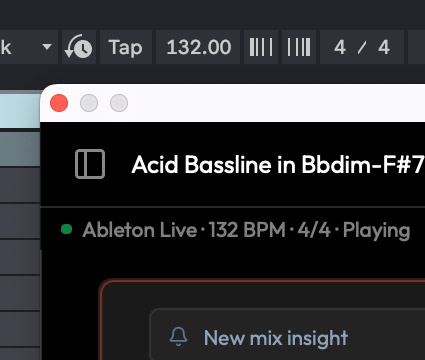
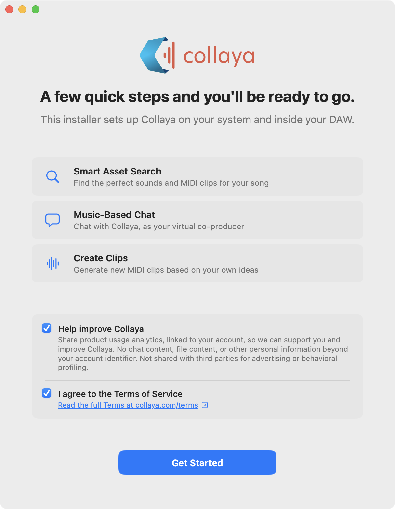
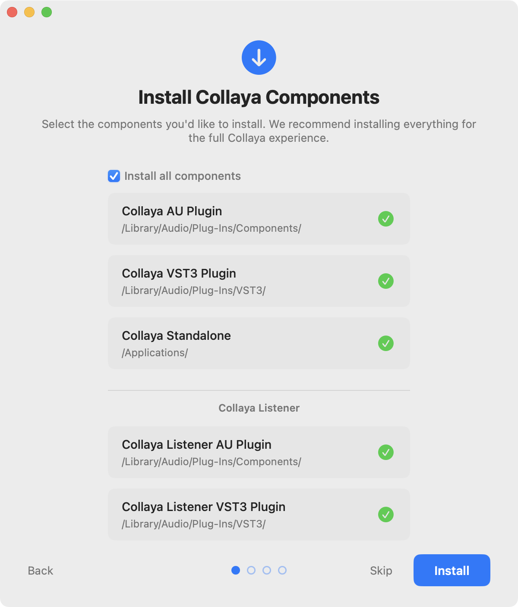
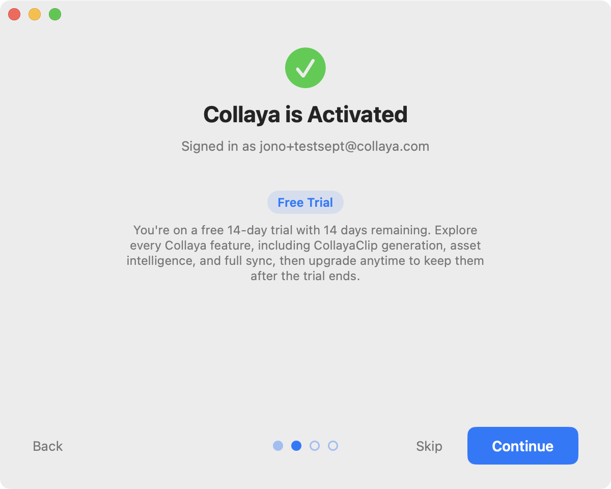
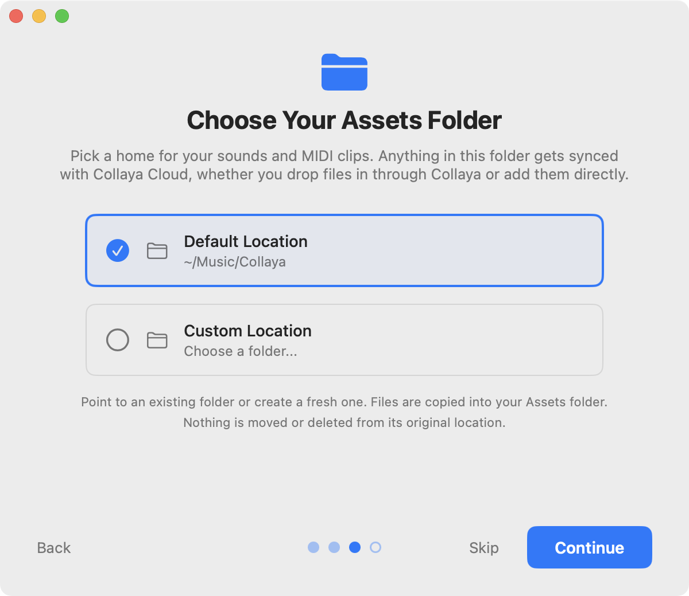
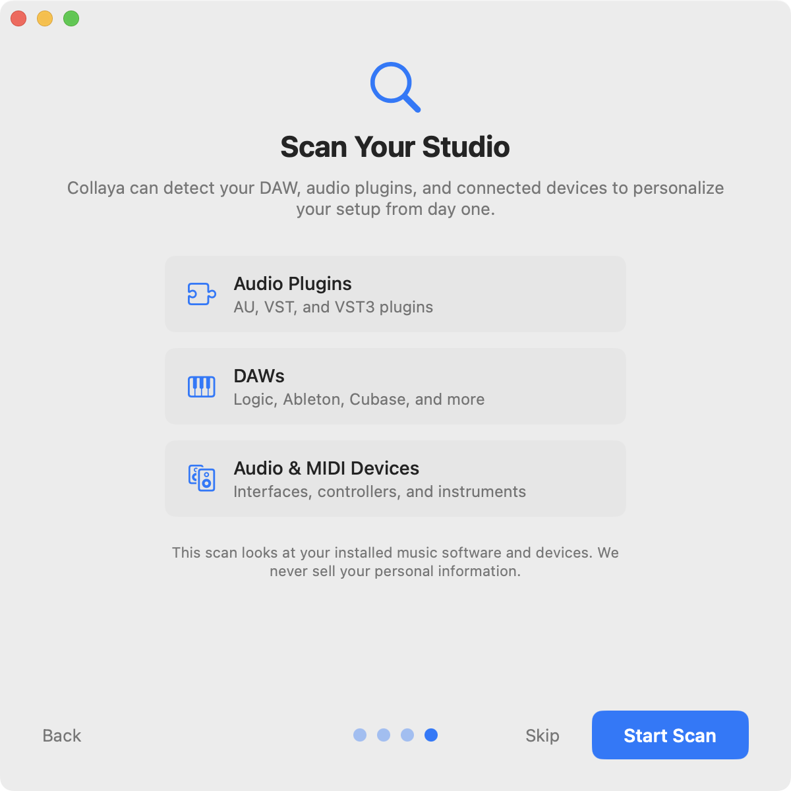
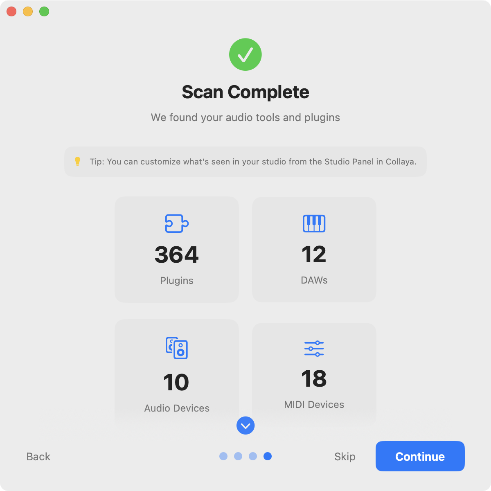
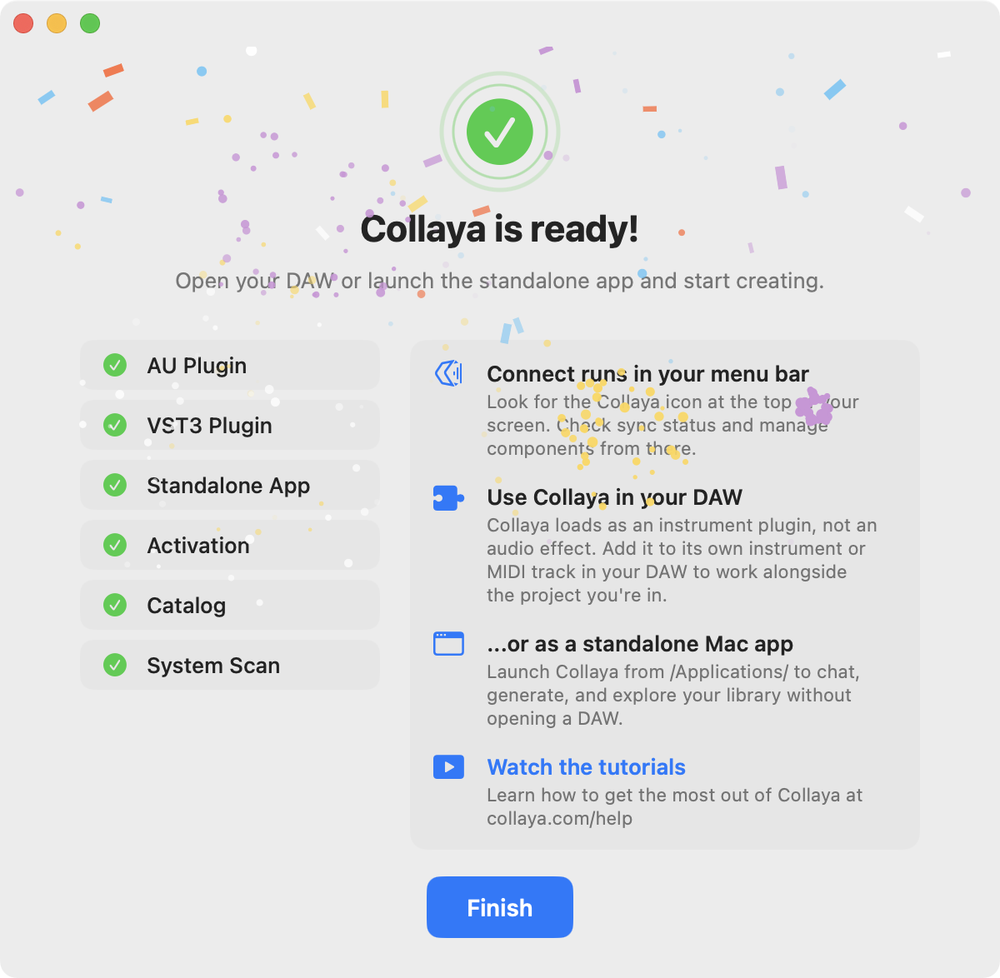

## Overview

Collaya is an artist-first music-tech platform and audio plugin. It generates new ideas from a musician's own audio and MIDI rather than from other people's records, and acts as a virtual co-producer: a consent-based stance on music AI, taken when most of the industry was moving the other way.

{/* VERIFY: this file is named "listener-indaw-tab". Confirm it shows what the caption says. */}

I founded the company, set the direction, and designed and built the plugin, the marketing site, and the connective tissue in between.

Collaya started as a web app. I assembled the small team that built it, designed the product, and wrote parts of the front end myself. The most consequential decision I made was to stop building the web version and start again from the ground up as a plugin and native macOS app. Seven months after the plugin's first commit, it launched publicly.

## Where it belongs

<Pin>

The web app worked. You uploaded your sounds, Collaya listened and thought about them, and then you could have a real conversation about the material you were working on. That part was good, and it is still the heart of the product today.

The core concept was the innovation. The workflow around it was the problem. Stop the session, switch apps, bounce a reference out of the DAW, upload it, wait, then talk. Every step is trivial, and together they cost more than most ideas are worth. The workflow also capped what Collaya could know: beyond what a musician deliberately handed it, it couldn't see the work. Not the tempo, not the key, not anything on the timeline. Every session began with a musician describing their song to software that could not hear it, which is a strange thing to ask of a collaborator.

</Pin>

The plugin was always the long-term plan. The web version shipped first because it was the fastest way to put the idea in front of musicians and learn whether it deserved to exist. Beta users answered that, and more: the idea was worth building, just not in a browser. They wanted Collaya inside the DAW, where they already work. So we stopped building the web app. It went into maintenance mode, then offline entirely, and the plugin got our full focus until launch.

<Pin>

A plugin closes both gaps. Inside the session, Collaya reads tempo and transport state directly from the host, and hears key and chords through its own analysis. It auditions ideas matched to the project's tempo, in time with the track already playing. A generated MIDI clip leaves as a drag onto the timeline. Bringing in your own sounds is still there whenever you want it. It just stopped being the price of admission.

</Pin>

## What stayed behind

By the time we moved, the web app had grown into a destination: an arrangement editor, stem separation, audio generation, collaboration tools. A plugin is a sidecar, so every feature had to justify a place in it. Early metrics and user interviews made most of those calls.

**Arrangement.** Musicians told us candidly that they wouldn't arrange outside their DAW. Our editor had grown complex and was competing with the tool they already trusted for the job, and a plugin window is the wrong place to rebuild it. The DAW owns arrangement.

**Stem separation.** Nobody had asked for it, and musicians already had tools that do it well, including the separator built into Ableton Live.

**Audio generation.** This was the clearest signal of all. When I announced Collaya on Reddit, the mention of audio generation was enough for musicians there to call it the enemy. Many musicians don't want generated audio anywhere near their work, and a product asking for a place in their session has to take that seriously. Audio generation stayed out of the plugin.

{/* NOTE: stem separation copy removed in 1.5.2. The server still replies "Audio clip generation is coming soon!" (backlog). "Stayed out of the plugin" is true either way; delete this comment when ready. */}

What stayed was what mattered: the conversation, and the musician's own sounds.

I priced most of the move's costs in before committing. They still arrived in five parts:

**The addressable market got much smaller.** A browser reaches everyone. An AU/VST3 plugin reaches macOS, initially Apple Silicon only, with Windows moving from a question to a later one. What came back was focus: everyone left is someone actually writing music in a DAW, bedroom producers through working professionals. A far clearer audience than everyone.

**Distribution stopped being a URL.** A signed installer, Apple notarization, a self-updating companion app, separate install paths per format. There is no hot fix. A version that goes out stays out until users update it, which changes how carefully you think before shipping.

**One codebase became four.** Real-time C++ for the audio engine, Swift for the macOS companion app, Python for the API, React for the interface, each with its own build system, debugger, and failure modes.

**Support changed shape.** The most common issue we see is not a bug. Collaya makes sound, so it loads as an instrument, which means Logic lists it among software instruments rather than audio effects. That is the format behaving as designed, and a category of confusion I inherited the moment I chose this form factor. It can't be designed away, so the answer now sits in setup, before a musician ever goes looking for it.

**Almost none of it carried over.** One analysis service survived the move. The interface, the application logic, and everything underneath were written from scratch, which meant discarding work a team had shipped rather than work I could quietly rewrite on my own time.

I took the trade because of what sits on the other side of it. A tool you can adopt in a browser tab is also a tool you can abandon in one. A tool that lives in the session, that knows the tempo without being told, becomes part of how someone works. The web app was easier to build, easier to ship, and easier to forget. Moving into the DAW made the product harder in every dimension and made it real.

## Starting at the hub

Collaya Connect installs and updates every piece of Collaya software, so it's the first thing a musician opens, and onboarding lives there. Six steps take a new user from welcome to ready: choose which components to install, activate, pick a home for their sounds, scan their studio, and finish. The scan detects their DAW, plugins, and audio and MIDI devices so Collaya starts out knowing their setup. The library step answers the question every musician has before they ask it: nothing is moved or deleted from its original location.

{/* IMAGE PLACEHOLDER: Collaya Connect onboarding (the six steps, or the studio scan).
    */}

<Slides>

</Slides>

Because of how Connect handles onboarding, by the time a musician opens Collaya in their DAW, setup is behind them.

## Designing the co-producer

There is one way to ask Collaya for anything: a single text box. No Generate button, no mode switch, no model picker. A musician types the way they'd talk to a producer in the room, and Collaya works out whether that's a question, a request for a MIDI idea, or a search through their own library.

Every message quietly carries what a collaborator in the room would already know: the session's tempo and transport state, the sounds the musician has selected, the plugins and instruments they own, and, when they switch it on, what they've just played.

A generated idea arrives as a clip card inside the conversation: a small piano roll, the bar count and tempo, and three actions. **Play** auditions it, and with Latch on it waits for the DAW's transport so the idea comes in with the track. **Save** writes it to the musician's library. **Drag** stays disabled until the save lands, then drops the clip onto the timeline. Generate, audition, keep, use, all without leaving the session.

{/* IMAGE PLACEHOLDER: a clip card in the conversation (piano roll, bars and tempo, Play / Save / Drag).
    */}

## When the AI is wrong

Language models are confidently wrong in ways a musician hears instantly, so most of the design work here is invisible. The principle: correct it quietly when the correction is certain, and say so plainly when it isn't.

{/* CONFIRM: the principle line is a summary of the pattern in the code, not a comment you wrote. Keep it only if it's how you'd describe your intent. */}

A clip that claims 32 bars and delivers 16 has its description and its name corrected to the real length. If the musician asked for meaningfully more, Collaya says so and offers to extend it. A clip that runs out of room mid-generation doesn't fail silently: Collaya explains it tried to pack in too much and offers a shorter version, sparser rhythms, or a split across clips. A recommended sample that isn't in the library gets a quiet note saying so instead of a dead end.

<Pin>

Chords were the sharpest case. The models name guitar chords reliably and finger them unreliably: one shape labeled "A" came back spelling a B minor, which any guitarist catches instantly. So Collaya trusts the name and throws the fingering away, replacing it with a canonical voicing from a library of 2,069 real guitar shapes before the diagram ever renders. No more AI thrown at an AI problem. Just a source of truth.

</Pin>

## Deciding what leaves the room

Follow Mode reads what a musician plays so Collaya can respond to it. The explanation of what that means sits beside the Follow toggle and stays visible even when Follow is off, because people want to read it before they turn it on. It's three plain lists: what stays on the device, what's sent only inside a chat message (key, last chord, progression, note density, and roughly the last 16 notes), and what's never sent (audio of any kind, or the full session). The last line: turn Follow off to send nothing.

{/* IMAGE PLACEHOLDER: the Follow toggle with its three lists (stays on device / sent in a message / never sent).
    */}

The Listener holds the same line. Its hearing is computed on the Mac, and only the description of what it heard, never the audio, reaches the conversation.

{/* SCOPE: library files do sync to cloud storage. Do not widen this section to "nothing leaves your Mac." */}

## A guest in someone else's app

All of this happens inside someone else's app.

It loads inside Logic, Ableton, Bitwig and most other Mac DAWs, hosts I don't control, can't patch, and can't ask to behave differently. On the other side is a professional in flow, carrying a decade of muscle memory and no interest whatsoever in learning my software. Their tolerance for friction isn't low. It's zero.

An unexpected system dialog. A keystroke that stops doing what it has always done. A chord diagram that's subtly wrong. None of those read as a rough edge. They read as *this thing is broken*, and the session never gets interrupted for it again.

This is the tax every plugin developer pays, and the bar is set by companies who have been paying it for twenty years. Collaya loads into the same rack as tools from FabFilter, Native Instruments and u-he, and nobody grades a newcomer on a curve.

**The spacebar.** Producers hit space to play the track they're working on. It's the key their hand rests on, and Collaya's embedded interface was swallowing it: a guest breaking the most basic house rule. Now the DAW gets the spacebar by default, and Collaya keeps it only while a musician is typing in chat. Musicians who would rather use space to audition sounds in Collaya can turn that off, and the arrow keys work the same way. Getting there took native first-responder handling, because the standard keystroke hook isn't even called for a bare space in Logic or Ableton. Tab can't be forwarded at all, since macOS hands it to the focused window, so I left that limit in place rather than ship a fix that half worked.

{/* VERIFY: confirm the Tab limit is actually in the help docs. The instrument-slot issue turned out not to be. */}

**The dialog I didn't cause.** macOS 15 began showing users a system permission prompt that named Logic Pro as the culprit. A scary dialog that looks like your DAW's fault shakes confidence in your whole setup. The trigger turned out to be the plugin reading a small settings file, which macOS judges against whichever app performs the read. Storage now routes through Collaya Connect, which holds that permission legitimately. Ten hours to find. Users see nothing, which is the point.

## What the Listener taught us

The Listener is a second plugin. It sits on a channel and reports what it hears. We first built it for the technical side of a session: levels, balance, frequency conflicts between instances.

Early users heard something else in the name. They put it on a guitar track and waited for it to tell them which chords were being strummed, what the rhythm under the arpeggiated bass was doing, what the synth pad breathing underneath the song actually was. Not the mix. The composition.

<Pin>

The gap between what we built and what people assumed was a better brief than the one we wrote ourselves. So we rebuilt its hearing around composition: key, chords, single notes, tone, and rhythm, all worked out on the Mac without sending audio anywhere, and fed into Collaya's chat so the co-producer arrives already knowing what's in the song. It reached our Catalyst plan in June and every plan in September.

Being right turned out to be only half of it. The chord reader won't name a chord until three notes are sounding, which is correct, but a bassline or a held melody note left the center of the display blank, and the feature read as broken. So the Listener learned to name single notes too. A sustained pad flipped to "Percussive" as its notes faded, so the label now holds steady through the fade. Underneath, chord accuracy went from 65% to 99% across a test sweep of chord types and voicings.

</Pin>

{/* CONFIRM: claim only the Listener decisions you made or directed. */}

## The system underneath

The brand's palette carries from collaya.com through the plugin, the standalone app, and the Listener, and one typeface, Outfit, runs through every surface. Inside a window the host controls, the interface adapts to the space it's given: panels collapse and rebalance, and components like the guitar-tab card fold their actions into a menu when room runs short. Musicians can scale the type up or down and reset the layout in one click.

{/* VERIFY: run the palette check before publishing the first sentence. */}

The team has changed shape more than once since 2024. Today I work across all four codebases myself, with a second pair of eyes on QA. That's only possible with heavy AI leverage, and it stays shippable because of what surrounds it: unit tests on the correctness-critical signal processing, adversarial code review, and a security script gating every release. The models make the building fast. Deciding what gets verified before it reaches a musician is the part I own.

## Outcome

Collaya launched publicly in May 2026 with paying users: two AU/VST3 plugins that run in most Mac DAWs, the Collaya Connect companion app, and the cloud platform behind them. Version 1.5 in September brought the Listener's full hearing to every plan.

Growth has been slow, and I'd rather say that plainly than dress up a number. Musicians are conservative about what they let into a session, and whatever trust this product earns has to be earned inside their environment, on their terms.

What travels is knowing where a model can be trusted and where it can't, and designing for the difference.

Collaya asks for a place in the room where someone makes their music, next to tools from companies many times its size. Building something worthy of that place is the most complete work I have done.
