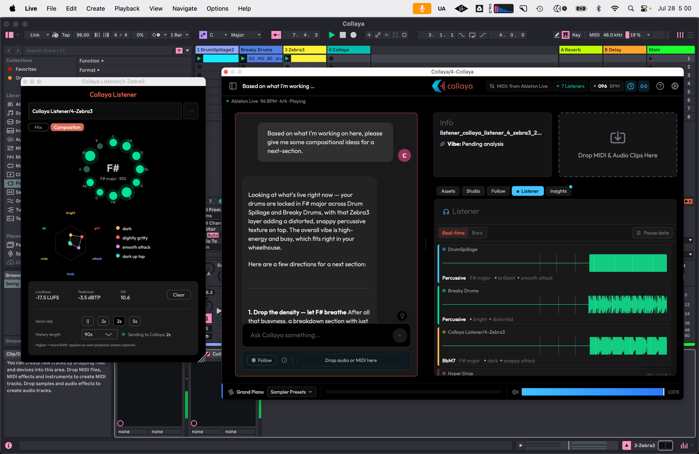
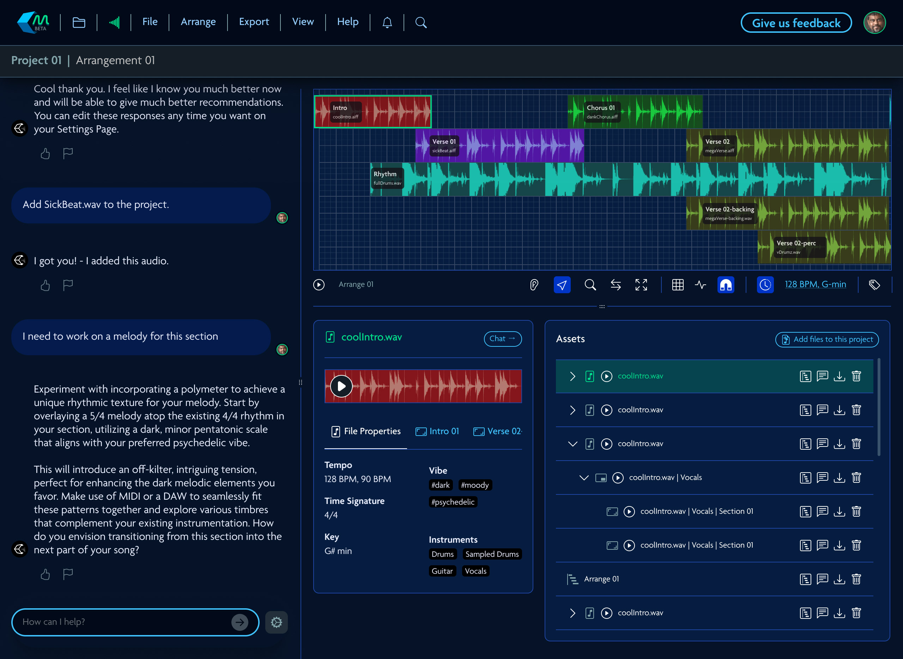
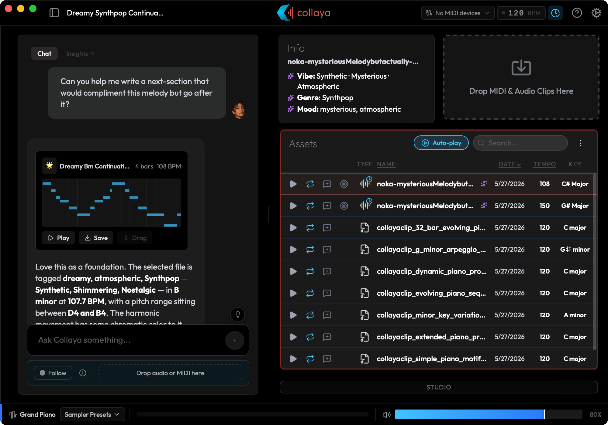
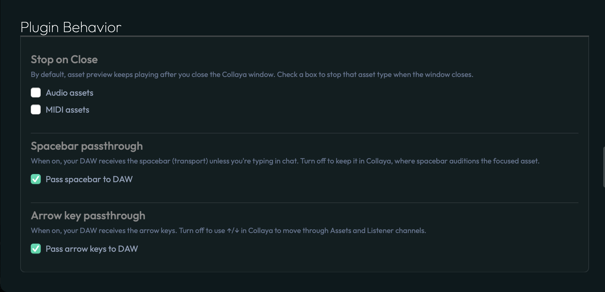
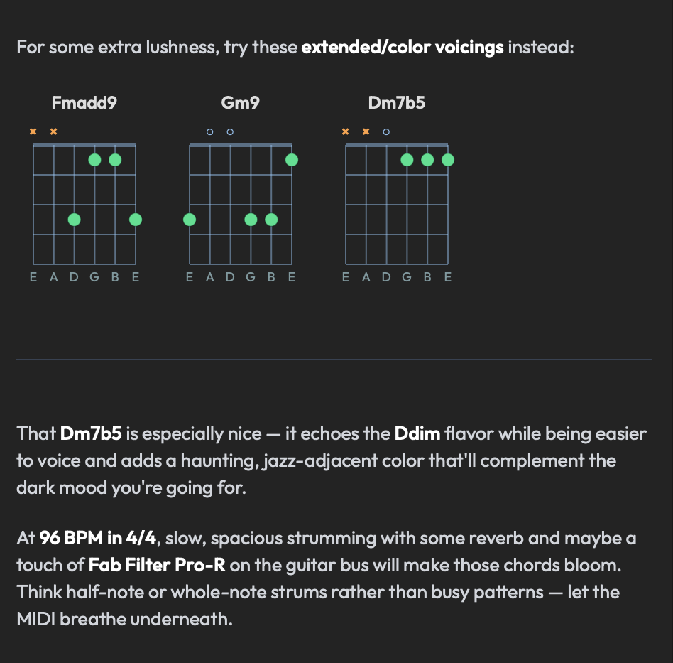
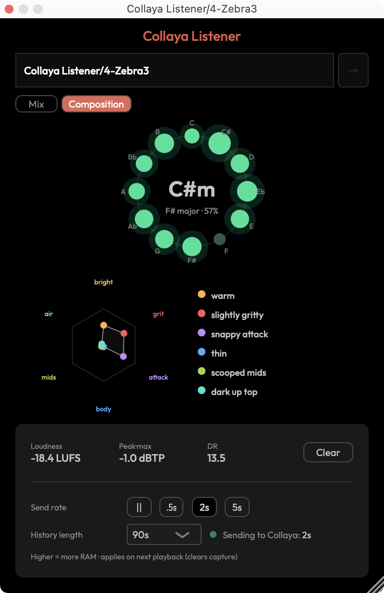

## Overview

Collaya is an artist-first music-tech platform and audio plugin. It generates new ideas from a musician's own audio and MIDI rather than from other people's records, and acts as a virtual co-producer: a consent-based stance on music AI, taken when most of the industry was moving the other way.

I founded the company, set the direction, and designed and built the plugin, the marketing site, and all the connective tissue in between.

Collaya started as a web app. I assembled the small team that built it, designed the product, and wrote parts of the front end myself. The most consequential decision I made was to stop building the web variant and start again from the ground up as a plugin and native macOS app.

## Where it belongs

<Pin>

The web app worked. You uploaded your sounds, Collaya listened and thought about them, and then you could have a real conversation about the material you were working on. That part was good, and it is still the heart of the product today.

The core concept was the innovation. The workflow around it was the problem. Stop the session, switch apps, bounce a reference out of the DAW, upload it, wait, then talk. Every step is trivial, and together they cost more than most ideas are worth. The workflow also capped what Collaya could know: beyond what a user deliberately handed it, it couldn't see the work. Not the tempo, the key, the arrangement, or anything on the timeline. Every session began with a musician describing their song to software that could not hear it, which is a strange thing to ask of a collaborator.

</Pin>

The plugin was always the intention. It predates the web version, which existed because it was the fastest way to put the idea in front of people and learn whether the conversation was worth having. Beta users answered that, then kept answering a question I hadn't asked: they wanted Collaya where they already worked. The feedback didn't set the direction so much as collapse the time it took to commit to it.

<Pin>

A plugin closes both gaps at once. Inside the session, Collaya reads tempo, key and transport state directly from the host. It auditions sounds through the DAW's own output, time-stretched and pitch-shifted to the project, against the track already playing. A generated MIDI clip leaves as a drag onto the timeline. Bringing in your own sounds is still there whenever you want it. It just stopped being the price of admission.

</Pin>

I priced most of this in before committing. It still arrived in five parts:

**The addressable market got much smaller.** A browser reaches everyone. An AU/VST3 plugin reaches macOS, initially Apple Silicon only, with Windows moving from a question to a later one. What came back was focus: everyone left is someone actually writing music in a DAW, bedroom producers through working professionals. A far clearer audience than everyone.

**Distribution stopped being a URL.** A signed installer, Apple notarization, a self-updating companion app, separate install paths per format. There is no hot fix. A version that goes out stays out until users update it, which changes how carefully you think before shipping.

**One codebase became four.** Real-time C++ for the audio engine, Swift for the macOS companion app, Python for the API, React for the interface, each with its own build system, debugger, and failure modes.

**Support changed shape.** The most common issue we see is not a bug. Collaya makes sound, so it loads as an instrument, which means Logic lists it in the software instrument slot rather than alongside audio effects. That is the format behaving as designed, and a category of confusion I inherited the moment I chose this form factor. I can document it. I cannot design it away.

**Almost none of it carried over.** One analysis service survived the move. The interface, the application logic, and everything underneath were written from scratch, which meant discarding work a team had shipped rather than work I could quietly rewrite on my own time.

I took the trade because of what sits on the other side of it. A tool you can adopt in a browser tab is also a tool you can abandon in one. A tool that lives in the session, that knows the tempo without being told, becomes part of how someone works. The web app was easier to build, easier to ship, and easier to forget. Moving into the DAW made the product harder in every dimension and made it real.

## The challenge

That decision has a consequence: Collaya is a guest in someone else's app.

It loads inside Logic, Ableton, Bitwig and most other Mac DAWs, hosts I don't control, can't patch, and can't ask to behave differently. On the other side is a professional in flow, carrying a decade of muscle memory and no interest whatsoever in learning my software. Their tolerance for friction isn't low. It's zero.

An unexpected system dialog. A keystroke that stops doing what it has always done. A chord diagram that's subtly wrong. None of those read as a rough edge. They read as _this thing is broken_, and the session never gets interrupted for it again.

This is the tax every plugin developer pays, and the bar is set by companies who have been paying it for twenty years. Collaya loads into the same rack as tools from FabFilter, Native Instruments and U-He, and nobody grades a newcomer on a curve.

## What I did

Snapshots rather than a survey. Three problems that came out of that constraint, and what each took.

**The spacebar.** Producers hit space to play back the track they're working on. Collaya's embedded web view swallowed it, and the standard hook for intercepting a keystroke isn't even called for a bare space in Logic or Ableton, so the obvious fix doesn't exist. 

**_Solution:_** It took native first-responder management: the web view holds the keyboard only while a text field is focused, otherwise space passes to the host. Tab turned out to be unforwardable, since macOS hands it to the focused window and there is no appeal. So I documented the limit rather than ship a fix that half-worked.

**The chords.** 
The underlying language models that Collaya utilizes would name chords reliably and _fret_ them unreliably; one labeled "A" came back spelling a B minor. A guitarist catches that instantly - this is a critical moment of broken trust for most users. 

<Pin>

**_Solution:_** Instead, I designed a mini-model which rewrites each shape against a **correct** canonical chord database before it renders it. The diagram shows the chord's name, plus the correct chord diagram, not the model's guess.

</Pin>

**The dialog I didn't cause.** macOS 15 began throwing a system permission prompt at users and blaming _Logic Pro_ for it. 

**_Solution:_** Ten hours to find: the plugin read a small settings file in a shared container, and macOS judges that read against whichever app performs it. The break came from noticing that Collaya's own Listener touched the same container over a socket and never triggered it. The file read was the trigger, not the container. Storage now routes through the companion app, which holds that permission legitimately. Users see nothing - "no news is good news".

## What the Listener taught us

The Listener is a second plugin. It sits on a channel and reports what it hears, built to cover the technical side of a session: levels, balance, frequency conflicts between instances.

Early users heard something else in the name. They put it on a guitar track and waited for it to tell them which chords were being strummed, what the rhythm under the arpeggiated bass was doing, what the synth pad breathing underneath the song actually was. Not the mix. The composition.

<Pin>

**_Solution:_** The gap between what we built and what people assumed was a better brief than the one we wrote ourselves. So we rebuilt the analysis to hear compositional detail and feed it into Collaya's chat, so the co-producer arrives already knowing what is in the song. It ships shortly, and it moves the whole workflow somewhere new.

</Pin>

## Working across four codebases

The team has changed shape more than once since 2024. Today I work across all four codebases myself, with a second pair of eyes on QA. That's only possible with heavy AI leverage, and it stays shippable because of what surrounds it: unit tests on the correctness-critical DSP, adversarial code review, a security script gating every release. The chord-correction layer is that same instinct aimed at the models themselves. The models make the writing fast. Deciding what gets verified before it reaches a musician is the part I own, and it's what makes the speed worth having.

## Outcome

Collaya launched publicly in May 2026 and is live with paying users: an AU/VST3 plugin that installs into any modern Mac DAW, a macOS companion app, and the cloud platform behind them, shipping continuously.

Growth is slow and deliberate, and I'd rather say so plainly than dress up a number. The lesson is the one the engineering kept teaching: musicians are conservative about what they let into a session, and every bit of trust this product earns has to be earned inside their environment, on their terms. A slow way into the category, and the only durable one.

What travels is knowing where a model can be trusted and where it can't, and being willing to go all the way down to the audio thread to cover the difference.

That is also the part I'm proudest of. Collaya asks for a place in the room where someone makes their music, next to tools from companies many times its size, and it holds that place. Building something that earns it, across four codebases and every layer from the audio engine to the cloud, is the most complete work I have done.
